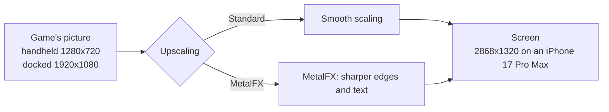
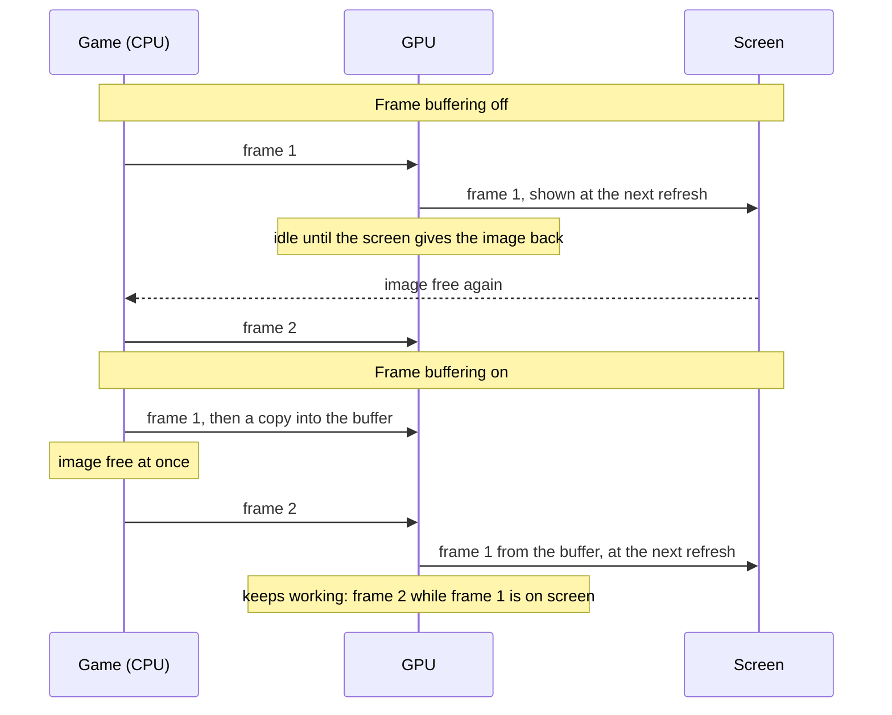
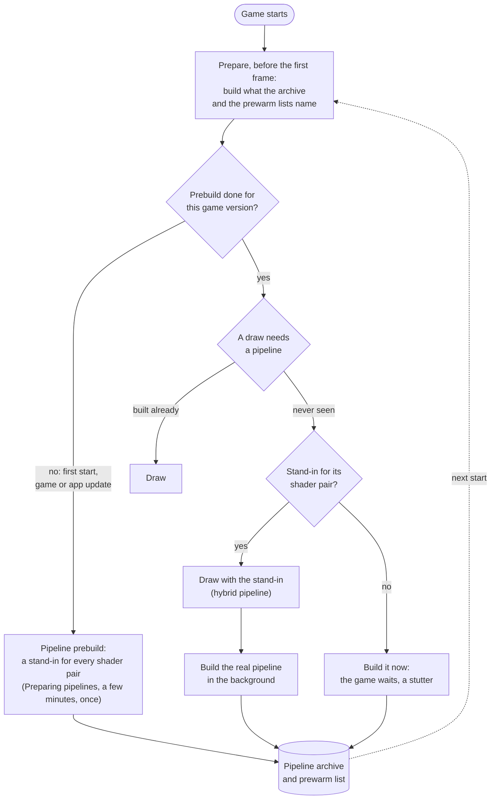
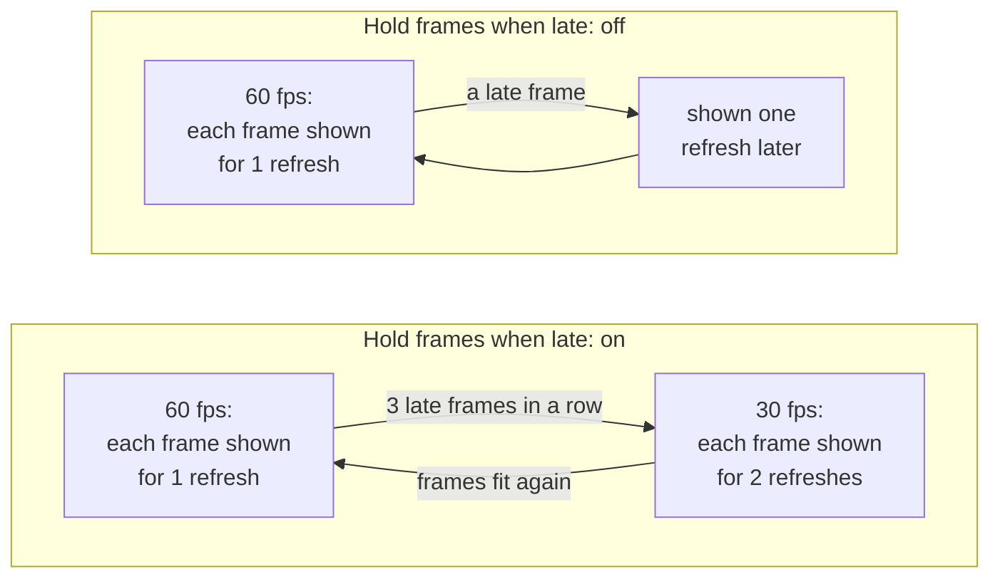

# Configurações

A tela antes do jogo começar mostra as configurações que o jogo suporta. Uma configuração que só importa enquanto outra está ligada aparece sob ela e desaparece quando aquela é desligada. Toque em **Play** para iniciar; o app lembra suas escolhas para a próxima inicialização. Todas as configurações ficam em uma única tela rolável, sob **Game**, **Controls** e **Performance**. Toque em um menu ou mova um slider ali; nenhuma página de configurações precisa ser aberta. **Upscaling** fica em **Game**, ao lado de **Console mode**. Um app para Mac mostra as mesmas configurações em uma [janela própria](#a-janela-de-configuracoes-no-mac).

- [Defaults testados](#defaults-testados)
- [Jogo](#jogo): [Frame rate](#frame-rate), [Render scale](#render-scale), [Modo do console](#modo-do-console), [Upscaling](#upscaling), [Idioma do jogo](#idioma-do-jogo), [Contador de frame rate](#contador-de-frame-rate)
- [Controles](#controles): [Feedback tátil](#feedback-tatil), [Rumble do jogo](#rumble-do-jogo), [Força do rumble](#forca-do-rumble), [Corte do rumble](#corte-do-rumble)
- [Performance](#performance): [Buffering de frames](#buffering-de-frames), [Pipelines do Metal 4](#pipelines-do-metal-4), [Prebuild de pipelines](#prebuild-de-pipelines), [Thread de encode](#thread-de-encode), [Segurar frames quando atrasam](#segurar-frames-quando-atrasam), [HUD de performance](#hud-de-performance), [Restaurar os defaults testados](#restaurar-os-defaults-testados)
- [A janela de configurações no Mac](#a-janela-de-configuracoes-no-mac): [Modo de exibição](#modo-de-exibicao)
- [TV](#tv)
- [Configurações em arquivo](#configuracoes-em-arquivo)

## Defaults testados

Cada jogo vem com as configurações com que foi testado: seu profile neste repositório diz, por exemplo, que Breath of the Wild roda com Frame buffering e Metal 4 pipelines ligados, porque essa combinação manteve 60 fps estáveis em um iPhone 17 Pro Max. Esses são os defaults que a tela de configurações mostra na primeira vez.

Quando você muda uma configuração e toca em **Play**, o app guarda sua escolha, inclusive quando um build posterior do app traz outros defaults. Uma configuração que você deixa em seu default não é guardada: ela segue os defaults do build que você tem, então as configurações testadas de um build mais novo chegam até você sem você fazer nada. **Reset to tested defaults**, no fim da tela, devolve toda configuração ao seu default, e **Play** então esquece suas escolhas, para que os defaults do jogo voltem a valer. Para testes, uma linha em `Documents/env.txt` sobrepõe qualquer configuração ([Configurações em arquivo](#configuracoes-em-arquivo)).

Um app para Mac carrega a mesma lista (`Contents/Resources/dm/launcher.json`), sem o Frame-rate counter e o Touch feedback próprios do iPhone, para um frontend que inicia o app com os valores escolhidos ([Frontends](frontends.md)).

## Jogo

### Frame rate

Jogos cuja velocidade o app controla (Breath of the Wild, Tears of the Kingdom e alguns outros) oferecem **30 fps** ou **60 fps**. 60 é mais fluido; 30 é o que o Switch rodava e gasta menos energia, então o telefone esquenta menos e a bateria dura mais. O jogo roda em velocidade real dos dois modos.

### Render scale

O tamanho da imagem 3D, de 50 a 100 %. Abaixo de 100 % o tamanho fica fixo ali e a resolução dinâmica própria do jogo é desligada; 100 % mantém a do próprio jogo. Menor pode pesar menos na GPU, mas fica mais borrado; o HUD e o texto mantêm a nitidez. Só jogos que o app consegue escalar oferecem isso.

### Modo do console

**Docked** renderiza na resolução de TV do Switch, **Handheld** na resolução portátil, menor, que pesa menos no telefone e pode dar um frame rate maior.

### Upscaling

Um jogo que renderiza abaixo da resolução da tela é escalado até a tela. **Standard**, o default, escala suavemente; **MetalFX** usa o upscaler MetalFX da Apple, que realça bordas e texto ao escalar.

Breath of the Wild renderiza 1280x720 no modo portátil. No docked ele renderiza seu mundo em 900p e escala isso para 1080p por conta própria, antes de o app ver a imagem. O MetalFX funciona nos dois modos: no portátil economiza mais tempo de GPU e gera menos calor; no docked fica mais nítido que a escala suave. Renderizar na resolução da tela continua sendo a imagem mais nítida, onde a GPU suporta.

- **Quando mudar:** ligue se a imagem parecer pouco nítida e o dispositivo tiver tempo de GPU sobrando: em um Mac, ou em um iPhone no modo portátil a 30 fps. Para sessões longas a 60 fps em um iPhone, deixe em Standard.
- **Custo:** mais tempo de GPU a cada frame, o que pode aumentar o calor em um iPhone. As medições de Breath of the Wild cobrem Mac e iPhone; ainda não foram medidos o run de Standard correspondente no iPhone e a parcela do custo térmico que é do MetalFX. Nada muda enquanto a imagem do jogo tem o mesmo tamanho da tela. Dispositivos e tamanhos não suportados usam a escala Standard.
- **No Mac:** escolha **MetalFX** em **Upscaling**, nos Advanced settings da [janela de configurações](#a-janela-de-configuracoes-no-mac), ou defina `DM_PRESENT_UPSCALE=metalfx` em seu `env.txt` (desligado por padrão). Ajuda em uma janela grande ou em uma tela 4K.

### Idioma do jogo

Os próprios idiomas do jogo. O app foi empacotado com um deles; escolha outro aqui sem reempacotar.

### Contador de frame rate

Mostra os frames por segundo no canto superior esquerdo.

## Controles

### Feedback tátil

Um toque leve do telefone quando você pressiona um botão na tela.

### Rumble do jogo

A vibração do jogo, no telefone ou em um controle conectado.

### Força do rumble

A intensidade da vibração do jogo, de 0 a 300 %.

### Corte do rumble

Uma vibração de controle mais fraca que isto fica desligada, e o resto é espalhado por toda a faixa. Desligado (0 %) por padrão. Um controle com motores de rotação pode vibrar o tempo todo num jogo que envia uma vibração sutil: Mario Kart 8 Deluxe precisa de uns 45 % para vibrar só em batidas e drifts. A vibração do próprio telefone não é afetada.

## Performance

Estas configurações mudam como o app entrega frames à tela e como ele prepara o trabalho da GPU. Os defaults testados do jogo são um bom ponto de partida; mude-os quando um jogo engasgar, rodar quente, ou quando você quiser menos latência.

### Buffering de frames

Cada frame pronto é copiado para um buffer de duas imagens de que a tela mostra, então o jogo pode começar seu próximo frame de imediato em vez de esperar a tela devolver sua imagem.

Sem isso a GPU fica ociosa entre frames, e o iOS lê essa ociosidade como folga: ele reduz o clock da GPU, e os frames demoram ainda mais. Em um iPhone 17 Pro Max, Breath of the Wild caía para 30 fps sem frame buffering e mantinha 60 com ele.

- **Quando mudar:** desligue se você notar o controle atrasando e o jogo mantiver seu frame rate sem ele.
- **Custo:** até um frame a mais de latência entre seu input e a tela (uns 28 ms a mais em um iPhone 17 Pro Max), e duas imagens a mais do tamanho de um frame na memória.

### Pipelines do Metal 4

Antes de a GPU poder desenhar algo, o app precisa construir uma *pipeline* para aquilo: os shaders do jogo compilados para a GPU do iPhone, com as configurações de desenho. Construir uma leva dezenas de milissegundos, então uma cena cheia de pipelines novas causa travadas. Com as pipelines do Metal 4 o app guarda o que construiu em um pipeline archive no telefone, e constrói a maioria das pipelines em poucos microssegundos a partir de uma base compartilhada.

Na inicialização, antes do primeiro frame do jogo, o app prepara o que já conhece: as pipelines do archive e as que as prewarm lists nomeiam (uma vem com o jogo, outra cresce no telefone conforme você joga); com um archive quente, isso leva bem menos de um segundo. Uma pipeline nunca vista é desenhada nesse meio-tempo com uma stand-in para seu par de shaders, uma pipeline *híbrida* que lê os vértices do draw de forma genérica e desenha a mesma imagem, enquanto a pipeline real é construída em background e arquivada para a próxima inicialização.

- **Quando mudar:** desligue apenas se um jogo travar ou ficar sem memória com ele.
- **Custo:** memória para o archive enquanto o jogo roda, e armazenamento no telefone.

### Prebuild de pipelines

Constrói uma stand-in para cada par de shaders que o jogo tem (15.767 em Breath of the Wild) e as coloca no pipeline archive, para que uma cena que você nunca viu tenha uma stand-in para cada um de seus draws em vez de uma travada. Ele roda antes do primeiro frame do jogo, atrás de uma tela **Preparing pipelines**: a primeira inicialização espera alguns minutos por ele, uma vez, e o mesmo vale para a primeira inicialização depois de uma atualização do jogo ou do app que traga shaders novos. Toda outra inicialização o pula. Ele precisa das pipelines do Metal 4, e sua linha só aparece enquanto aquela opção está ligada.

Construídas em background durante o jogo, as stand-ins levaram a GPU de um iPhone 17 Pro Max de cerca de 13 para 15–18 ms por frame em Breath of the Wild, então o app faz esse trabalho adiantado.

- **Quando mudar:** desligue se você não quiser esperar naquela primeira inicialização.
- **Custo:** ligado, uma espera de alguns minutos, uma vez. Desligado, sem espera, mas uma pipeline vista pela primeira vez faz o jogo parar um pouco enquanto ela é construída, até o archive guardá-la.

### Thread de encode

O app converte os comandos gráficos do jogo em comandos Metal em uma thread própria, em vez da thread de submissão do jogo, para que a thread do jogo possa continuar mais cedo (em Breath of the Wild cerca de 4 ms por frame em vez de 8). O frame buffering precisa dela para jogos que apresentam seus frames por uma thread diferente da que os desenha. Ela é ligada por padrão no iPhone; no Mac é desligada, onde reduziu o tempo típico de frame, mas deixou os frames mais lentos ainda mais lentos.

- **Quando mudar:** deixe ligada a menos que um jogo se comporte mal com ela; desligá-la é um passo de diagnóstico.

### Segurar frames quando atrasam

Para jogos cujo frame rate o app controla ([Frame rate](#frame-rate)). Com 60 fps escolhidos, cada frame deve ficar na tela por um refresh. Quando um frame chega atrasado, o app pode desacelerar o jogo para 30 fps por um tempo, ou manter 60 e mostrar os frames atrasados conforme chegam.

- **Ligado** (o default da maioria dos jogos): 30 fps (ou 20) redondos em cenas pesadas, em vez de uma mistura de 30 e 60.
- **Desligado:** o jogo continua mirando nos 60; um frame atrasado é mostrado um refresh depois e o próximo segue normalmente, então as cenas pesadas parecem menos uniformes, mas ficam mais perto de 60 em média.
- **Quando mudar:** desligue se o jogo cair muitas vezes para 30 fps embora esteja só levemente atrasado.

### HUD de performance

O overlay de performance da Apple sobre o jogo: frame rate, tempos de frame e de GPU, memória. Útil para ver o que uma configuração muda; deixe desligado para jogar.

### Restaurar os defaults testados

Devolve toda configuração ao default testado do jogo; **Play** então esquece suas escolhas, para que esses defaults valham, e também os de builds posteriores ([Defaults testados](#defaults-testados)). Configurações fixadas por `Documents/env.txt` continuam como o arquivo diz.

## A janela de configurações no Mac

Um app para Mac ([Um app para Mac](development.md#a-mac-app)) mostra suas configurações em uma janela antes do jogo começar. São as mesmas configurações que no iPhone, com os mesmos defaults. A janela mostra primeiro as mais usadas: **Frame rate**, **Render scale**, **Console mode**, **Game language**, **Display mode** e **Game rumble**, quando o jogo as tem. **Render scale** mostra o tamanho da imagem em pixels ao lado da porcentagem para o **Console mode** escolhido, quando o profile do jogo tem isso (Breath of the Wild: 1600 × 900 docked, 1280 × 720 handheld a 100 %). As demais ficam sob **Advanced settings**, nas seções habituais, com **Reset to tested defaults**. A janela lembra se os Advanced settings estão abertos. **Frame-rate counter** e **Touch feedback** só existem no iPhone.

Clique em **Play** (ou aperte Return) para iniciar o jogo. **Quit**, ⌘Q ou fechar a janela encerra o app sem o jogo. O app lembra suas escolhas para aquele jogo, e um jogo iniciado sem a janela, por um frontend ou com a janela desligada, também as usa ([Escolhas salvas](frontends.md#escolhas-salvas)). Uma configuração fixada por um `env.txt` ou pelo programa que iniciou o app é mostrada acinzentada.

Desligue **Show this window at launch** para iniciar o jogo de imediato com suas escolhas. Segure Option enquanto o app abre para ver a janela de novo. `DM_LAUNCHER=0` no `env.txt` do app (`~/Library/Application Support/nxnative/<title ID>/env.txt`) ou em seu ambiente, ou abri-lo com `open <app> --args --no-launcher`, também pula a janela; suas escolhas continuam valendo. `DM_SAVED_CHOICES=0` inicia com os defaults testados em vez disso.

### Modo de exibição

**Window** ou **Fullscreen**: como a janela do jogo abre. ⌃⌘F ou o botão verde mudam isso durante o jogo. Em um `env.txt`: `DM_FULLSCREEN=1` ou `0`.

### Pasta dos cloud saves

**Choose a folder…** escolhe a pasta do iCloud Drive pela qual o save do jogo é sincronizado, a que o app de iPhone escolheu no **Cloud saves** do seu launcher, ou a pasta própria do jogo dentro dela, nomeada pelo seu title ID ([Saves na nuvem](#saves-na-nuvem)); **Turn off** para encerrar. Desligado por padrão. O macOS pode perguntar uma vez se o app pode abrir o iCloud Drive; se o log do jogo disser `this app may not open iCloud Drive`, permita em System Settings › Privacy & Security › Files and Folders. Em um `env.txt`: `DM_SAVE_SYNC=<pasta>`, ou `DM_SAVE_SYNC=icloud` para iCloud Drive › nxnative Saves; a janela então o mostra como fixo.

## Saves na nuvem

O app de Mac e o app de iPhone de um mesmo jogo podem compartilhar um save pelo iCloud Drive. Escolha a mesma pasta do iCloud Drive nos dois: **Cloud saves** › **Choose a folder…** na janela de configurações do Mac, e **Cloud saves** no launcher do iPhone (qualquer pasta, por exemplo uma chamada **nxnative Saves**). Cada jogo guarda ali um arquivo, `<title ID>/save.dmsync`, que contém o save inteiro.

Quando o jogo inicia, ele traz o save do iCloud Drive se aquele for o que deve ficar; alguns segundos depois de o jogo salvar, ele envia seu save. O app de iPhone também envia quando vai para segundo plano, e o app de Mac quando o jogo fecha. Se você jogou nos dois sem o save ter passado de um para o outro no meio, o save mais novo vence.

Um save que é substituído, no dispositivo ou no iCloud Drive, é guardado primeiro, ao lado do save em uma pasta nomeada com `-backups` (no iPhone, `save-backups` no app Arquivos, sob o nome do app; no Mac, `~/Library/Application Support/nxnative/<title ID>/save-backups`): `<date> local` guarda o save deste dispositivo, `<date> cloud` o que estava no iCloud Drive. Os 10 mais novos de cada tipo ficam, e os mais antigos são removidos; outras pastas que você colocar ali são deixadas em paz.

O iCloud Drive leva um momento para levar um arquivo de um dispositivo ao outro. Feche o jogo em um dispositivo e dê alguns segundos antes de iniciá-lo no outro. Sem conexão, o jogo segue com o save que tem e o envia depois. O log do jogo diz o que entrou e o que saiu (linhas começando com `save sync:`).

## TV

Conecte uma TV ou monitor por cabo, ou inicie o Screen Mirroring para uma Apple TV ou TV com AirPlay. O jogo a preenche em 16:9 a até 1080p e muda para **Docked**; o iPhone ou iPad mantém os controles. Desconecte para devolver o jogo ao dispositivo, no modo anterior. O AirPlay adiciona algum atraso; um cabo quase nenhum.

## Configurações em arquivo

Uma linha como `DM_PRESENT_SNAP=0` em `Documents/env.txt` (no app Arquivos, sob o nome do app) define uma configuração a partir do arquivo: a tela de configurações a mostra acinzentada, e o arquivo vence sua escolha e o default do jogo. Feche o app por completo e abra-o de novo depois de editar o arquivo. As variáveis:

| Configuração | Variável | Valores |
|---|---|---|
| Frame rate | `DM_FPS_TARGET` | `30`, `60` |
| Render scale | `DM_RENDER_SCALE` | `0.5` a `1.0` |
| Modo do console | `DM_OPMODE` | `1` docked, `0` handheld |
| Idioma do jogo | `DM_LANG` | um código de idioma, como `ja` |
| Modo de exibição (Mac) | `DM_FULLSCREEN` | `1` fullscreen, `0` janela |
| Pasta dos cloud saves (Mac) | `DM_SAVE_SYNC` | uma pasta; `icloud`: iCloud Drive › nxnative Saves; `0`: desligado |
| Contador de frame rate | `DM_SHOW_FPS` | `1`, `0` |
| Feedback tátil | `DM_TOUCH_HAPTICS` | `1`, `0` |
| Rumble do jogo | `DM_RUMBLE` | `1`, `0` |
| Força do rumble | `DM_RUMBLE_GAIN` | `0` a `3` |
| Corte do rumble | `DM_RUMBLE_MIN` | `0` a `0.9` |
| Upscaling | `DM_PRESENT_UPSCALE` | `off`, `metalfx` |
| Buffering de frames | `DM_PRESENT_SNAP` | `1`, `0` |
| Pipelines do Metal 4 | `DM_PSO_MTL4` | `1`, `0` |
| Prebuild de pipelines | `DM_PSO_PREBUILD` | `1`, `0` |
| Thread de encode | `DM_NVN_ENC_THREAD` | `1`, `0` |
| Segurar frames quando atrasam | `DM_FPS_HOLD` | `on`, `off` |
| HUD de performance | `DM_METAL_HUD` | `1`, `0` |

`DM_LAUNCHER=0` pula a tela de configurações; as escolhas que você salvou ali continuam valendo. `DM_SAVED_CHOICES=0` inicia com os defaults testados e guarda suas escolhas salvas para depois. Como as configurações são listadas para cada jogo: [dm/games/settings.tsv](../dm/games/settings.tsv).
